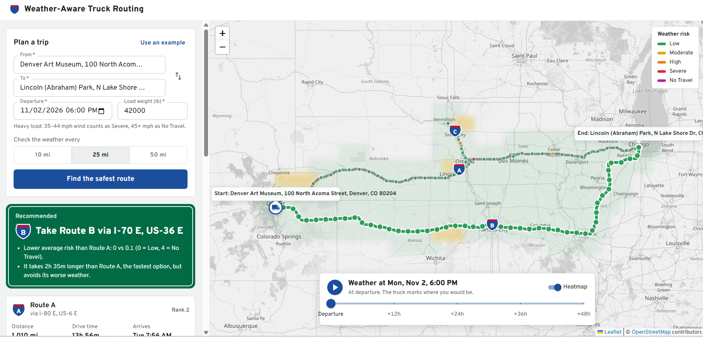

# Weather-Aware Truck Routing


A React + Material UI web app with a Django REST backend that helps a truck driver pick the safest route.
It gets three truck routes, checks the forecast at every checkpoint **for the hour the truck will actually be there**,
applies the risk and load rules, and recommends the route with the least dangerous weather, using drive time only as the final tie-breaker.

- **Live app:** https://weather-aware-truck-routing-5h7c.onrender.com/ (free hosting, so the first load after it has been idle can take about a minute)
- **Walkthrough, part 1 (the product and the logic):** <Loom link>
- **Walkthrough, part 2 (the engineering):** <Loom link>



## What you can do

- Enter origin, destination (search-as-you-type), departure time, load weight and a checkpoint spacing of 10, 25 or 50 miles.
- See 3 routes on the map. The selected route is colored by risk along its length; every checkpoint shows its arrival time, wind, rain, snow, risk level and the reason for it.
- Read the recommendation and why it won ("Fewer Severe miles than Route A: 0 vs 42 mi"), plus the time trade-off against the fastest route.
- Scrub or play a **0–48 hour forecast slider**: the weather heatmap over the trip corridor updates instantly and a truck icon shows where you would be at that hour.
- Compare routes side by side: distance, drive time, arrival, miles per risk level and average risk.

## How a trip is planned

1. **Places**: the typed text is geocoded with TomTom (skipped when a suggestion with coordinates was picked).
2. **Routes**: TomTom truck routing returns the best route plus up to 2 alternatives, using the gross vehicle weight (load + 35,000 lb tractor-trailer, capped at 80,000 lb) so weight-restricted roads are avoided. If fewer than 3 distinct routes come back, the service asks for routes through points to each side of the trip's midpoint.
3. **Checkpoints**: at mile 0, every N miles, and at the destination. Each arrival time comes from TomTom's per-point travel times, so slow city stretches and fast interstates are timed correctly.
4. **Weather**: one batched Open-Meteo request fetches hourly wind, rain and snowfall for every checkpoint and heatmap cell. Points are snapped to a 0.1° grid so overlapping routes share forecasts, and results are cached for 30 minutes.
5. **Risk**: each checkpoint uses the forecast hour nearest its arrival time and is classified by the rules below.
6. **Ranking**: routes are sorted by the recommendation order below, and the deciding rule is explained in plain words.
7. **Heatmap**: a grid of cells within about 30 miles of every route; risk is computed for all 49 hours up front, so the slider needs no network calls.

## Risk rules

| Condition | Low | Moderate | High | Severe | No Travel |
|---|---|---|---|---|---|
| Wind | < 25 mph | 25–34 | 35–44 | 45–54 | ≥ 55 mph |
| Rain | < 0.10 in/hr | 0.10–0.25 | 0.25–0.50 | 0.50–1.00 | > 1.00 |
| Snow | < 0.5 in/hr | 0.5–1.0 | 1.0–2.0 | 2.0–3.0 | > 3.0 |

Load rules: ≥ 55 mph is No Travel for any load; 45–54 mph with more than 30,000 lb is No Travel; 35–44 mph with more than 40,000 lb is Severe.

A checkpoint's level is the **worst** of wind (after load rules), rain and snow. Shared boundaries (such as 0.25 in/hr) go to the higher band; "> 1.00" and "> 3.0" are strict, exactly as the table reads. The rules live in one file: [`backend/trips/services/risk_service.py`](backend/trips/services/risk_service.py).

## Route recommendation

Routes are ranked by, in order:

1. Fewest **No-Travel** miles (added so a route you shouldn't drive can never win on other numbers)
2. Fewest **Severe** miles
3. Fewest **High** miles
4. Lowest **average risk** (weighted by miles, 0 = Low to 4 = No Travel)
5. Shortest **travel time**

Each checkpoint stands for the road halfway back to the previous checkpoint and halfway forward to the next, so the miles per level always add up to the route length at any spacing.

## Decisions and assumptions

- **Wind** is Open-Meteo's sustained 10 m wind speed. **Rain** is `rain + showers` (showers are the convective, thunderstorm part). **Snow** is hourly snowfall in inches.
- Weather at a checkpoint uses the forecast hour closest to the arrival time.
- Departures must be within the next 7 days so the whole trip and the 48-hour heatmap stay inside the forecast range.
- Arrival times assume continuous driving; a natural next step is adding Hours-of-Service rest breaks.
- Both providers' free tiers have daily or monthly limits, so geocoding and weather results are cached.
- On the live site the visitor's browser downloads the forecasts (`WEATHER_FROM_BROWSER=true`). Open-Meteo's free plan is limited per IP address and free hosting shares one address between many apps, so the server hands the browser the exact requests and still does all the risk work itself.

## Project structure

```
backend/                     Django + DRF (no database: everything comes from APIs)
  config/                    settings, root URLs, WSGI
  trips/
    views.py                 thin controllers: validate, call one service, return
    serializers.py           request validation
    container.py             builds services and their dependencies (singletons)
    domain.py / dtos.py      internal models / JSON response shapes
    geo.py                   distances, positions along a polyline, slicing
    exception_handler.py     every error becomes {"detail": "..."}
    clients/                 TomTom, Open-Meteo, and fake clients for tests and demo mode
    services/                places, routes, checkpoints, weather, risk, assessment, recommendation, heatmap, planner
    tests/                   44 tests: rules, ranking, arrival times, heatmap, parsers, API, browser weather
frontend/                    React 19 + TypeScript + Material UI + Leaflet (Vite)
  src/api/                   typed API client
  src/hooks/                 useTripPlan, useDebouncedValue, useDemoMode
  src/components/            form, recommendation sign, route cards, checkpoint table
  src/components/map/        map, routes, checkpoints, heat layer, truck, timeline, legend
  src/lib/                   risk colors, formatting, route geometry
```

## Run it locally

**Backend** (Python 3.12)

```bash
cd backend
python -m venv .venv
.venv\Scripts\activate          # macOS/Linux: source .venv/bin/activate
pip install -r requirements.txt
copy .env.example .env          # macOS/Linux: cp; then add TOMTOM_API_KEY (free at developer.tomtom.com)
python manage.py runserver
```

No key yet? Set `USE_FAKE_PROVIDERS=true` in `.env` to run on built-in demo data (try Denver to Chicago).

**Frontend** (Node 22)

```bash
cd frontend
npm install
npm run dev                     # http://localhost:5173 (forwards /api to Django)
```

**Tests:** `cd backend` then `python manage.py test`.

## Deploy

The `Dockerfile` builds the React app and serves it from Django (WhiteNoise), so the whole app is one service and one URL. It runs on Render's free plan: New, then Blueprint, then select this repo (it reads `render.yaml`), and set `TOMTOM_API_KEY`.

## API

| Method | Path | Purpose |
|---|---|---|
| `POST` | `/api/trips/plan` | Plan a trip (routes, checkpoints, risk, recommendation, heatmap) |
| `GET` | `/api/places/suggest?q=denv` | Place suggestions for the search box |
| `GET` | `/api/health` | Health check (also reports demo mode) |

Errors always come back as `{ "detail": "..." }`: 400 for invalid input, 422 when a place or route can't be found, 502 when an upstream API fails.

## Free services used

TomTom (routing and place search), Open-Meteo (weather), OpenStreetMap (map tiles), Render (hosting) and GitHub Actions (tests). None needs a payment card.

---

Routing and geocoding by [TomTom](https://developer.tomtom.com). Weather by [Open-Meteo](https://open-meteo.com). Map tiles © OpenStreetMap contributors.